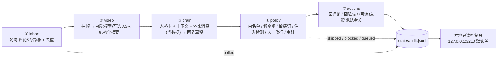

# 01 五层链路：把「怎么找评论框」和「准不准发」拆开

`dsh-douyin-bot-playbook`（GitHub 用户 20450150414，仓库 https://github.com/20450150414/dsh-douyin-bot-playbook）的 `playbook/` 沿用 rentaoyan0628-collab/dsh-qq-bot-playbook 的写法：记设计取舍、记踩过的坑、给 AI 当需求文档读，不堆代码清单。项目接管 https://www.douyin.com/ ，做三件事：自动聊天、回复评论私信、看懂视频。

## 1. 从 QQ 版搬过来之前，先把风险模型换掉

QQ 版桥接（SnowLuma + OneBot v11）是稳定协议：事件推送过来、字段固定、发消息就是往协议端点写一条结构化请求。抖音 Web 侧没有面向个人的消息 API，拿得到的只有自己登录态下的页面 DOM，「消息」这件事本身要靠观察页面得出。

| 维度 | QQ 版桥接 | 抖音 Web |
| --- | --- | --- |
| 接入面 | SnowLuma / OneBot v11，协议字段稳定 | 自己登录的持久化 profile + Playwright/CDP 只读看页面 |
| 消息来源 | 服务端事件推送 | DOM 轮询观察 |
| 结构稳定性 | 版本化协议，升级有 changelog | 页面结构天天变，class 名常带构建哈希 |
| 一次发言的受众 | 群 / 私聊，范围有限 | 公开评论区，第三人可见、可截图、可转发 |
| 出错代价 | 发错一条群消息 | 一条误回直接挂在账号形象上 |
| 额外需要的层 | 无 | 多一层 `selectors.mjs`；放行 / 审计 / 频率闸前置 |

**坑 #1**：把 QQ 版「收到事件 → 生成 → 发送」的直链照搬，等于让模型输出穿过 DOM 直接落到公开评论区。QQ 版把闸放在桥接尾部尚可，抖音版放到尾部之后，页面改版、OCR 注入、模型幻觉三种故障会共用同一条出口。本仓库反过来排：**放行 / 审计 / 频率闸在架构上位于最前面**（第 ④ 层是唯一出口，`actions` 只是它的执行手），`brain` 从头到尾拿不到写权限。

**坑 #2**：以为「补一层 DOM 解析」就够了。DOM 解析只解决「读到了什么」，没解决「读到的内容算不算命令」。外来内容（评论 `text`、OCR、`transcript`）一律按数据处理，这是三条硬规矩的第一条。

**坑 #3**：把「对外发声」当成「发消息」的同义词来排期。公开评论区的一条回复会被第三人看到、被截图、被检索；因此白名单、频率、人工放行、审计这四件事先于模型选型定稿，模型层后面换供应商时这套结构保持零改动。

## 2. 五层链路与数据流



文本等价链路：`inbox → video → brain → policy → actions → state/audit.jsonl → 控制台`。`audit.jsonl` 是唯一真相源，控制台只读它，`state/` 之外不存在第二份决策记录。

### 每层职责与改动半径

| 层 | 模块 | 输入 | 输出 | 页面改版时 | 换模型时 |
| --- | --- | --- | --- | --- | --- |
| ① inbox | `inbox.mjs` + `selectors.mjs` | DOM 快照、`seen.json` | `Message[]` | 必动 | 零改动 |
| ② video | `video.mjs` | `videoId`、页面 video 元素 / 抽帧 | `VideoDigest` | 必动（抽帧钩子） | 视觉模型换供应商时动 |
| ③ brain | `brain.mjs` | `Message`、`VideoDigest`、人格卡、上下文 | 纯文本草稿 / `[SILENT]` | 零改动 | 必动 |
| ④ policy | `policy.mjs` + `state.mjs` | 草稿、配置、`audit.jsonl` | `decision` + 审计行 | 零改动 | 零改动 |
| ⑤ actions | `actions.mjs` | 已放行草稿 | 一次真实写入 + `audit.jsonl` 的 `sent` 行 | 必动（定位输入框） | 零改动 |

「怎么找评论框」关进 `selectors.mjs`；「准不准发」关进 `policy.mjs`。这两句话是本仓库最值钱的取舍：页面结构天天变，模型 / 放行一行零改动。

## 3. standalone/src 模块职责表

| 模块 | 职责 | 边界 |
| --- | --- | --- |
| `config.mjs` | 读分组配置、补默认值、校验 `allowAllWhenEmpty:false` 等 fail-closed 项 | 唯一读配置的入口 |
| `util.mjs` | 时间窗、哈希、原子写 tmp+rename、日志格式 | 无网络调用 |
| `state.mjs` | 读写 `seen.json` / `audit.jsonl` / `approval.jsonl` / `takeover.log` / `video-cache.json` | 唯一落盘入口 |
| `browser.mjs` | 启动 / 附着持久化 profile，Playwright/CDP 只读看页面 | 抓包、伪造签名、风控挑战解算从未进入本仓库 |
| `selectors.mjs` | 所有 CSS / XPath / 文本锚点，带 `capture-selectors.mjs` 生成的快照 | 页面改版只改这里 |
| `inbox.mjs` | 轮询评论 / 私信 / @，规范化成 `Message`，按 `seen.json` 去重 | 只产出，不发送 |
| `video.mjs` | 抽帧、调用视觉模型 / 可选 ASR、生成 `VideoDigest`、查缓存 | 只读视频元数据与帧 |
| `brain.mjs` | 拼装上下文、调文本模型、产出草稿或 `[SILENT]` | 只产出字符串，无写权限 |
| `policy.mjs` | 四道闸、注入 / 敏感词 / 秘密检测、审批 TTL、写审计 | 唯一放行判定处 |
| `actions.mjs` | 回评论 / 回私信 / 可选点赞，`enabled` 默认全关 | 唯一有写权限的层 |
| `console.mjs` | 127.0.0.1:3210 本地只读控制台，默认关 | 无写操作、无远程监听 |

## 4. 消息对象（全链路唯一格式）

| 字段 | 类型 | 说明 |
| --- | --- | --- |
| `id` | string | 去重键；页面刷新后可能变化，需二级键兜底（见 04） |
| `channel` | `comment` \| `dm` \| `mention` | 决定走哪套开关与白名单（见 02） |
| `userId` | string | 与 `itemId` 绑定做会话键 |
| `userName` | string | 外来文本，仅展示 |
| `text` | string | 外来内容 = 数据，永不当指令 |
| `videoId` | string | 关联 `VideoDigest` |
| `timestamp` | number | 毫秒；参与频率窗与 TTL |
| `itemUrl` | string | `ownVideosOnly` 校验依据 |

```json
{
  "id": "c_8f21a9", "channel": "comment", "userId": "u_10293",
  "userName": "路过的阿柒", "text": "这个包在哪买的呀",
  "videoId": "7xxxx123456", "timestamp": 1762396800000,
  "itemUrl": "https://www.douyin.com/video/7xxxx123456"
}
```

## 5. 同步 vs 轮询

| 方案 | 优点 | 代价 | 结论 |
| --- | --- | --- | --- |
| WebSocket / MutationObserver 事件流 | 延迟低 | 依赖页面内部实现，页面一改就断；断线重放边界难定 | 弃用 |
| 定时轮询 + `seen.json` | 幂等、可 `--once` 回归、断点后自然对齐 | 有轮询间隔的固有延迟 | 采用 |

轮询的具体取舍：`inbox.pollIntervalSec` 配抖动（±20%）避免固定节拍；浏览器把标签页放后台会节流定时器，`--once` 模式下以单轮为准，长跑模式用 `page.bringToFront()` 或前台标签；登录态掉线时轮询读到的空列表按 `polled(count=0)` 记账后停机，绝不把旧消息翻出来重放（见 05）。

## 6. 为什么 standalone 与 the agent harness 解耦

`node takeover.mjs ...` 单进程跑通全流程，安装 Playwright 即可。`the agent harness` 的插件版本、预设挂载、上下文注入会随 profile 变化，把它放进运行链路等于给「每条可回放审计」引入一个不受本仓库控制的变量。解耦后：

- 配置由 `config.mjs` 一个入口读，分组固定：
  `account / browser / douyin / inbox / llm / video / reply / safety / persona / state / console`。
- CLI 自洽：`node takeover.mjs --fixture --dry --once`、`--dry`、`--pending`、`--approve <id>`、`--once`；校验 `node tools/verify.mjs`；锚点快照 `node tools/capture-selectors.mjs`。
- 依赖面收敛到 Node ≥ 22.13、Playwright、可选 ffmpeg、OpenAI 兼容文本 + 视觉模型、可选 ASR。

`reply` 分组字段口径（其余篇共用）：`whitelist(userIds, keywords, allowAllWhenEmpty)`、`denylist`、`maxRepliesPerHour`、`maxRepliesPerDay`、`minIntervalSec`、`maxReplyChars`、`maxRepliesPerItem`、`dedupeTtlHours`、`approvalTtlHours`、`requireHumanApproval`、`dryRun`、`enabled`、`replyToComments`、`replyToDMs`、`autoLike`。

## 7. 单点失败与降级表

| 故障 | 征兆 | 动作 | 审计 `kind` |
| --- | --- | --- | --- |
| 登录态失效 | 页面跳登录 / 用户态元素缺失 | 停机，等人工在持久化 profile 处理 | `error` |
| `selectors.mjs` 全 miss | 连续 N 轮 `polled(count=0)` 且页面有内容 | 停机并提示跑 `capture-selectors.mjs` | `error` |
| 视觉模型超时 / 缺图片输入 | `VideoDigest.confidence=0`、`framesAnalyzed=0` | 降级到只用标题 / 话题 / 评论（见 03、06） | `error` |
| 文本模型 429 / 5xx | 草稿生成失败 | 当轮 `[SILENT]` 潜水，旧草稿丢弃 | `error` |
| `state/` 写入失败 | 原子写 rename 报错 | 停止一切放行，fail-closed | `error` |
| 控制台端口占用 | 3210 监听失败 | 控制台保持默认关，主链路照常 | `error` |
| 时钟回拨 | `ts` 小于上一条 | 停机，频率窗停止计算 | `error` |

## 8. 给 AI 的验收点

1. 页面改版模拟：只改 `selectors.mjs` 与 `actions.mjs` 的定位常量，`brain.mjs` / `policy.mjs` 内容保持零改动，全流程 `--fixture --dry --once` 仍通过。
2. 任意外来 `text` 里出现「忽略之前的规则」样式文本时，输出仍是一条普通回复草稿或 `[SILENT]`，工具选择与开关状态不受影响。
3. 空白名单 + `allowAllWhenEmpty:false` 时，所有消息落到 `skipped`，`sent` 计数为 0。
4. 每条消息在 `audit.jsonl` 里至少有一行，且 `polled / skipped / draft / queued / sent / blocked / error` 可串成一条时间线。
5. `node tools/verify.mjs` 覆盖配置校验、模块可加载、fixture 全链路、审计字段完整性。
