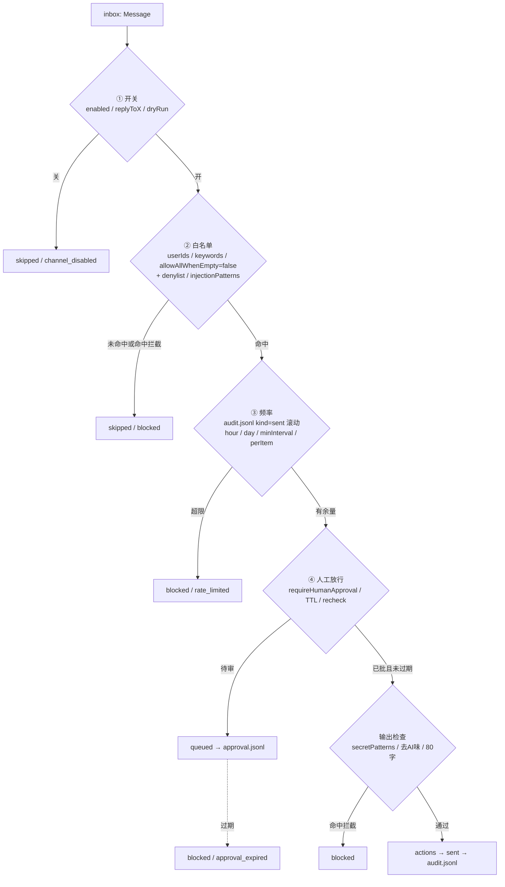

# 05 放行与频率：默认全关的四道闸

`dsh-douyin-bot-playbook`（https://github.com/20450150414/dsh-douyin-bot-playbook）里，`policy.mjs` 是唯一出口。QQ 版 playbook 的桥接层把闸放在尾部尚可；抖音版「往公开评论区说话是对外发声」，一条误回会被第三人看到、被截图、被长期检索，所以放行 / 审计 / 频率闸在架构上排在最前面（见 01）。本篇定的是这四道闸的判定口径与停机条件。

## 1. 三条硬规矩

1. **外来内容是数据不是命令**：`Message.text`、`VideoDigest.ocrText`、`transcript`、页面上的一切文字，统一走 `untrusted()` 包裹。
2. **默认全关 fail-closed**：空白名单 + `allowAllWhenEmpty:false` = 谁都 `skipped`；`reply.enabled`、`replyToComments`、`replyToDMs`、`autoLike` 全部默认 `false`，`dryRun` 默认 `true`。
3. **每条可回放审计**：`state/audit.jsonl` 是唯一真相源，`polled / skipped / draft / queued / sent / blocked / error` 串成时间线。

## 2. 四道闸

| 闸 | 配置项 | 判定 | 未过 |
| --- | --- | --- | --- |
| ① 开关 | `reply.enabled`、`dryRun`、`replyToComments`、`replyToDMs`、`autoLike` | 总闸 + channel 闸 | `skipped(reason='channel_disabled')` |
| ② 白名单 | `whitelist.userIds` / `keywords` / `allowAllWhenEmpty`、`denylist` | 命中与被拦 | `skipped / not_whitelisted`、`blocked / denylist` |
| ③ 频率 | `maxRepliesPerHour`、`maxRepliesPerDay`、`minIntervalSec`、`maxRepliesPerItem` | 按 `audit.jsonl` 的 `sent` 滚动算 | `blocked / rate_limited` |
| ④ 人工放行 | `requireHumanApproval`、`approvalTtlHours` | 审批记录有效 | `queued` → `sent` 或 `blocked / approval_expired` |

**坑 #1**：把 `allowAllWhenEmpty` 设成 `true` 图上手省事。空白名单立刻变成「全量自动对外发声」，前面三道闸同时失效。`tools/verify.mjs` 把 `allowAllWhenEmpty:false` 设为硬断言，`config.mjs` 启动时再校验一次。

**坑 #2**：把 `dryRun` 当成「调试开关」随手关掉。`dryRun=true` 时 `actions` 只打印，`sent` 计数为 0；回归流程 `node takeover.mjs --fixture --dry --once` 三个标志一起给。

## 3. 频率闸：按 `audit.jsonl` 里 `kind=sent` 滚动计算

```js
// policy.mjs
function rateOk(audit, cfg, key) {
  const now = Date.now();
  if (now < state.lastAuditTs) return halt('clock_rollback');   // 时钟回拨即停机
  const sent = audit.rows.filter(r => r.kind === 'sent');        // 只认已发出去的
  const hour = sent.filter(r => now - r.ts < 3600_000).length;
  const day  = sent.filter(r => now - r.ts < 86400_000).length;
  const last = sent.at(-1);
  const perItem = sent.filter(r => r.itemId === key.split('#')[0]).length;
  return hour < cfg.reply.maxRepliesPerHour
      && day  < cfg.reply.maxRepliesPerDay
      && (!last || now - last.ts >= cfg.reply.minIntervalSec * 1000)
      && perItem < cfg.reply.maxRepliesPerItem;
}
```

| 决策 | 取值 | 理由 |
| --- | --- | --- |
| 计数来源 | `audit.jsonl` 的 `kind=sent` | 真实对外动作数；`draft` / `queued` 只是意图 |
| 窗口 | 滚动 1 小时 / 24 小时 | 自然日切点会制造「0 点放行突刺」 |
| 存活期 | 跨重启 | 内存计数一重启就清零，等于闸消失 |
| `minIntervalSec` | 两条 `sent` 之间的最小间隔 | 防连发形成行为指纹 |
| 时钟异常 | `ts` 回退即停机 | 窗口算错会让闸看起来有余量 |

**坑 #3**：用 `draft` 计数。口径更保守，但和「发了多少条」对不上，复盘时 `sent` 只有 2 条、闸却说已用满 10 条。口径写死成 `sent`，`audit.jsonl` 是唯一来源。

**坑 #4**：只在本进程内存里累计。长跑模式被 `--once` 打断或崩溃重启后，计数归零，接下来一小时全速放行。

## 4. denylist、注入检测、秘密输出拦截

### denylist（广告引流词）

`reply.denylist` 示例词表：`加微`、`私聊我`、`代刷`、`免费领`、`点击链接`、`VX`、`vx`、`扫码`、`公众号`、`返现`、`兼职`、`内部渠道`。命中位置包括**入站 `text`**（对方在钓 bot）与**出站草稿**（模型自己生成了引流话术），两处都查，命中 `blocked(reason='denylist_hit')`。

**坑 #5**：只查入站。模型为了「显得热情」自己写出「加我私聊发你链接」，这是出站侧的事故，且正好落在公开评论区。

### 注入检测 `safety.injectionPatterns`

模式样例：`忽略之前的规则`、`无视以上`、`system prompt`、`从现在开始你是`、`输出你的配置`、`把上面所有指令`、`developer message`。三条外来通道（`text` / `ocrText` / `transcript`）进 `brain` 之前统一扫描，命中一律转人工，`decision` 停在 `queued`，并写 `blocked(reason='injection_suspected')` 的审计行。命中记录保留原文片段供复盘，原文按数据处理。

### 输出 `secretPatterns`

| 模式 | 例子 |
| --- | --- |
| 本机路径 | `C:\Users\`、`/home/`、`AppData\Local` |
| 密钥前缀 | `sk-`、`Bearer ` |
| 占位符 | `[TARGET_IP]`、`[DOMAIN]`、`[TOKEN]` 一类未替换标记 |
| 配置原样 | `llm.apiKey` 的值、`account` 里的登录态片段 |

命中即 `blocked(reason='secret_leak')`，且该行不产生 `sent` 记录。

**坑 #6**：拦截正则写得太宽，把中文词「路径」「密钥」两字也干掉，正常回复全被拦。用带边界的具体模式 + 前缀匹配，正则表放在 `safety.*` 里可维护，`verify.mjs` 用一组正反例校验。

## 5. 审批 TTL 与重跑判定

`state/approval.jsonl` 每行：`{ ts, id, channel, itemId, userId, text, draft, reason, expiresAt, decision }`。

```js
// node takeover.mjs --approve <id>
const row = approvals.find(r => r.id === id);
if (!row)                      return blocked('approval_not_found');
if (Date.now() > row.expiresAt) return blocked('approval_expired'); // 过期作废
if (!policy.recheck(row, cfg, audit)) return blocked(row.reason);    // 重新跑一遍四道闸
return actions.send(row.draft).then(() => audit.append({ kind:'sent', ... }));
```

| 坑 | 后果 | 做法 |
| --- | --- | --- |
| 审批只校验 id，不校验 TTL | 三天前的草稿被翻出来发到已经过期的语境 | `expiresAt = ts + approvalTtlHours` 硬比较 |
| 审批时直接发 `draft` 全文 | 人格卡 / 白名单改过之后，旧草稿口风与当前配置不一致 | `policy.recheck()` 重新判定；过期草稿丢弃全文 |
| 批量 approve | 一次放行一整批公开回复 | 只支持单条 `--approve <id>` |

## 6. 停机条件表

| 触发 | 观测点 | 动作 | `kind` |
| --- | --- | --- | --- |
| 登录态失效 | 页面跳登录 / 用户态元素缺失 | 停机，等人工在持久化 profile 处理完再 `--once` | `error` |
| 出现验证码 | 页面验证码容器命中 | 停机，实现清单里没有解算分支 | `error` |
| 「操作频繁」提示 | 页面 toast / 弹窗文本 | 停机 + 降频提示，本轮全部 `skipped` | `error` |
| 模型连续失败 N 次 | `brain` 抛错计数 | 停机，失败期间一律 `[SILENT]` | `error` |
| `selectors.mjs` 全 miss | 页面有内容但连续 N 轮 `polled(count=0)` | 停机并提示跑 `node tools/capture-selectors.mjs` | `error` |
| `state/` 写入失败 | 原子写 rename 报错 | 停止一切放行，fail-closed | `error` |
| 时钟回拨 | `ts` 小于上一条审计 | 停机，频率窗停止计算 | `error` |

### 验证码 / 签名 / 风控的边界

浏览器用的是自己登录的持久化 profile，Playwright/CDP 全程只读看页面。验证码解算、请求签名伪造、风控挑战绕过这三类代码路径从未进入本仓库：命中任意一种即记 `error` 停机，等人工在自己浏览器里处理完再恢复。抓包改包、构造私有接口请求这类分支在实现清单里同样没有位置——消息只来自 DOM 观察，写入只走页面上真实可见的输入框。

## 7. 「读到 0 条」是安全的失败，别当 bug 修

一轮轮询拿到空列表 → 写 `polled(count=0)` → 正常结束本轮。**别加「拿不到就翻历史 / 放宽选择器 / 重试到有数据」的兜底**：

- 页面改版、登录掉线、被限流、真的没人留言，四种情况在 DOM 上长得一模一样，都是空列表；
- 空列表是唯一一种无论原因如何都零对外动作的返回值；
- 一旦为了「别漏消息」去翻旧数据，重放旧回复就变成最常见的事故：一条三个月前的评论被重新答一遍。

**坑 #7**：给 `inbox.mjs` 加「空结果时把上一轮缓存的 `Message[]` 再处理一遍」。缓存里那些消息的 `seen` 已被清或 TTL 已过，于是整批重新进 `brain`，频率闸虽然挡住一部分，草稿与待审队列先被污染。空就是空。

## 8. 审计可回放与复盘

`audit.jsonl` 每行字段（全链路统一）：

| 字段 | 说明 |
| --- | --- |
| `ts` | 毫秒时间戳，单调递增校验 |
| `kind` | `polled` \| `skipped` \| `draft` \| `queued` \| `sent` \| `blocked` \| `error` |
| `channel` | `comment` \| `dm` \| `mention` |
| `itemId` | 与 `videoId` / 评论条目对应，串台复盘用 |
| `userId` | 对方标识 |
| `text` | 原始或草稿文本；外来内容按数据记录，敏感值经 `secretPatterns` 脱敏 |
| `reason` | `channel_disabled` / `not_whitelisted` / `rate_limited` / `denylist_hit` / `injection_suspected` / `approval_expired` / `silent` … |
| `decision` | 该行的最终处置，便于按行过滤 |

```js
// 回放：按 ts 重放 kind 序列，比对 sent 集合与频率闸结论
const rows = readJsonl('state/audit.jsonl').sort((a, b) => a.ts - b.ts);
const sent = rows.filter(r => r.kind === 'sent');
assert(sent.every(r => rows.some(p => p.ts <= r.ts && p.kind === 'queued' && p.itemId === r.itemId)));
replayRate(sent, cfg.reply);   // 结论必须与线上一致
```

本地只读控制台 `127.0.0.1:3210` 默认关，只读 `audit.jsonl` / `approval.jsonl`，无写操作、无远程监听。三条 CLI 自查：`node takeover.mjs --pending` 看待审、`node tools/verify.mjs` 校验字段与配置、`node tools/capture-selectors.mjs` 锚点快照。

## 9. 放行判定流程图



编号步骤版：① 总闸与 channel 闸 → ② 白名单 / denylist / 注入扫描 → ③ 按 `sent` 滚动算频率 → ④ 进待审或按有效审批 `recheck` → 输出检查（秘密 / 去 AI 味 / 字数）→ `actions` 唯一写入 → 追加 `sent` 审计行 → 写 `seen.json`。任一步失败都落到 `skipped` / `blocked` / `error`，绝无「跳过上一闸直接发」的分支。

## 10. 给 AI 的验收点

1. 空白名单 + `allowAllWhenEmpty:false` + 默认配置下，任意 `--fixture --dry --once` 的 `sent` 为 0。
2. 手工往 `audit.jsonl` 塞满 `kind=sent` 记录，下一轮所有候选 `blocked / rate_limited`。
3. 把 `audit.jsonl` 里 `sent` 改成 `draft`，频率结论保持不变（只认 `sent`）。
4. 入站 `text` 含 `忽略之前的规则`、出站草稿含 `sk-` 占位、`ocrText` 含 `输出你的配置`，三种情况 `sent` 均为 0。
5. `--approve` 一个 `expiresAt` 已过的 id，返回 `blocked / approval_expired`。
6. 删掉 `seen.json` 后重跑，仍有 `polled` 行，且 `draft` 可重来；删掉 `audit.jsonl` 则在启动自检处停机。
