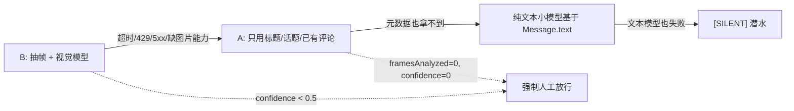

# 06 模型分流与成本：把钱花在看得见的地方

`dsh-douyin-bot-playbook`（https://github.com/20450150414/dsh-douyin-bot-playbook）里，模型调用只有两处：`brain.mjs` 出回复草稿、`video.mjs` 出 `VideoDigest`（可选 ASR 单独一路）。接管 https://www.douyin.com/ 之后，成本几乎全在「每张抽帧都要送进支持图片的模型」这一件事上。本篇定分流、prompt 预算、降级与估钱口径，给 AI 当容量规划的需求文档读。

## 1. 模型分流

| 用途 | 模型档 | 配置 | 典型入参 | 备注 |
| --- | --- | --- | --- | --- |
| 文本决策 / 回复草稿 | 小模型 | `llm.textModel`、`llm.baseUrl` | L1+L2+L3 + `VideoDigest` 块 + 6 条历史 | 纯文本， cheapest |
| 分类 / 摘要润色 / 去 AI 味复检 | 同上小模型或规则 | `llm.textModel` | 短 prompt | 能走规则的别调模型 |
| 视觉理解 | 支持图片输入的模型 | `video.visionModel` | `maxFrames=6` 张 PNG + 结构化输出要求 | 成本主体 |
| 口播 / BGM 转写 | 可选 ASR | `video.asrEnabled`、`video.asrModel` | 音频轨 | 默认关，按内容类型开 |

依赖面：Node ≥ 22.13、Playwright、可选 ffmpeg、OpenAI 兼容文本 + 视觉模型、可选 ASR。文本与视觉允许是不同 `baseUrl`，`config.mjs` 分组 `llm` / `video` 各读各的。

**坑 #1**：一个全能大模型包干。每张抽帧都按高单价计费，而回复草稿只需要几百 token 的小模型；一次「看懂视频 + 回一句话」的账单能差一个数量级。

**坑 #2**：视觉模型缺图片输入能力时硬塞 `image_url` 数组，拿到 400 之后整轮崩掉。`video.mjs` 启动时做一次能力探测，缺能力直接走降级链（见第 5 节），并产出 `framesAnalyzed=0`、`confidence=0` 的完整 `VideoDigest`。

## 2. prompt 拼装顺序与 token 估算

顺序与 04 篇一致：`L1 输出契约 → L2 人格卡 → L3 纪律补丁 → VideoDigest(不可信边界) → 本轮消息快照 → 输出`。

| 块 | 大致 token | 是否随消息增长 |
| --- | --- | --- |
| L1 输出契约 | 120 | 否 |
| L2 人格卡 | 250 | 否 |
| L3 纪律补丁 | 150 | 否 |
| `VideoDigest` 块（summary / topics / ocrText / transcript） | 180~350 | 略 |
| `historyItems=6` 的历史 | 120~300 | 是，封顶 6 条 |
| 当前 `Message` | 30~80 | 是 |
| 输出预留 | 200 | 否 |
| **文本小计** | **约 1.0k~1.4k** | — |

估算公式：

```
tokens_text ≈ Σ(中文字符 / 1.6) + 结构标记开销 + maxTokens(输出预留)
tokens_vision ≈ tokens_text_short + framesAnalyzed × imageTokensPerFrame
单次成本 ≈ tokens_text × PRICE_TEXT + tokens_vision × PRICE_VISION + asrSec × PRICE_ASR
```

`[PRICE_TEXT_IN]`、`[PRICE_TEXT_OUT]`、`[PRICE_IMAGE]`、`[PRICE_ASR_MIN]` 是留给你填的单价占位符，`llm.*` 里按供应商实际报价替换。

**坑 #3**：`maxTokens` 给到 1024「留足空间」。模型于是写小作文，超过 `maxReplyChars=80` 被 `policy` 拦下，输出 token 白付一遍，还多一次 `blocked` 审计。建议值见第 8 节。

## 3. 抽帧数量与成本的关系

| `maxFrames` | 视觉图块 token（相对） | 单次延迟 | 信息增益 | 适用 |
| --- | --- | --- | --- | --- |
| 1（仅封面） | 1× | 最低 | 低 | 降级 / 峰价时段 |
| 3 | 3× | 中 | 中 | 口播类短片 |
| **6（默认）** | **6×** | 2~8s | 高，覆盖片头 / 中段 / 片尾 | 默认 |
| 12 | 12× | 高 | 边际很小 | 排除 |

成本对 `maxFrames` 是**线性**的，信息量是对数形的；`frameIntervalSec=2` 保证帧不重复。

**坑 #4**：把 `frameIntervalSec` 调小想「看更细」。`maxFrames` 没变，但 seek 到未缓冲位置的概率上升，黑帧重拍次数涨，失败率与延迟一起涨，`framesAnalyzed` 反而下降（见 03）。

**坑 #5**：黑帧也送进视觉模型。黑帧照样按一张图计费，还把 `confidence` 拉低到需要人工放行，等于花两遍钱。`waitFor(['seeked','canplay'])` 失败即丢帧。

## 4. 缓存命中率对成本的影响

`video-cache.json` 键 `videoId|durationSec`，`cacheTtlHours=168`。

```
有效视觉调用数 = 本轮涉及的自己视频数 × (1 - hitRate)
日视觉成本 ≈ 有效视觉调用数 × maxFrames × PRICE_IMAGE
```

| 命中率 `hitRate` | 100 条评论涉及 20 条视频时的视觉调用 | 相对成本 |
| --- | --- | --- |
| 0 | 20 | 100% |
| 0.5 | 10 | 50% |
| 0.8 | 4 | 20% |
| 0.95 | 1 | 5% |

**取舍**：抖音评论长尾集中在发布后几天，7 天 TTL 能把「同一条视频下第 30 条评论」的视觉成本压到 0。TTL 调太短会重复付费，调太长则作者改了剪辑仍沿用旧 `summary`（键里带 `durationSec` 就是为这个）。

**坑 #6**：缓存键只写 `videoId`。作者换剪辑后 `durationSec` 变了，旧摘要继续被引用，`brain` 对着不存在的画面答话，事故看起来像模型幻觉，实际是缓存键漏了副键。

**坑 #7**：把帧的 base64 一起缓存。`state/video-cache.json` 只存 `VideoDigest` 文本字段，帧用完即弃。

## 5. 降级链



每一跳写 `audit.jsonl`：`error`（哪一跳失败、什么错）或 `skipped(reason='video_unavailable' / 'silent')`；`decision` 落在 `queued` 强制人工或 `skipped`。

**坑 #8**：降级时复用上一条视频的 `VideoDigest` 凑数。视觉层串台比 02 篇的 `userId` 串台更难查，因为 `summary` 读起来总是通顺的。降级只向下走，横向借数据一律禁止。

**坑 #9**：`framesAnalyzed=0` 时干脆不产出对象，下游 `brain` 对 `undefined` 取字段整轮崩。降级也必须产出结构完整的 `VideoDigest`（字段见 03）。

## 6. 超时 / 429 / 5xx 的失败语义

| 错误 | 当轮动作 | 重试 | 审计 |
| --- | --- | --- | --- |
| 请求超时 | `[SILENT]` 潜水，丢弃本轮草稿 | 下一轮重新生成 | `error` + `skipped / silent` |
| 429 | 同上，且看门狗计入限流计数 | 退避到下一轮 | `error` |
| 5xx | 同上 | 下一轮 | `error` |
| 输出不合契约 | `blocked` | 重生成上限 1 次 | `blocked / output_contract` |
| 视觉失败 | 走第 5 节降级链 | 下一轮 | `error` |

**核心语义：当轮潜水，旧回复一律不重放。**

**坑 #10**：给 `brain` 加自动 retry + 积压队列。模型恢复的瞬间，队列里 10 条半小时前生成的草稿一起涌向 `policy`；频率闸虽然挡住大部分，但草稿口风已经过期（人格卡期间改过、上下文早已换人），且待审队列被污染。失败即丢弃草稿是这里最便宜的做法。

**坑 #11**：把「上一轮没发出去的草稿」缓存起来等下次用。它对应的 `Message` 可能已被别人回复、已被删除，重放等于对空语境说话。

## 7. mock / fixture 零成本回归

| 命令 | 用途 | 模型调用 |
| --- | --- | --- |
| `node takeover.mjs --fixture --dry --once` | 全流程单轮回归 | 0，全部走 fixture |
| `node takeover.mjs --dry` | 真实页面只读观察 + 打印 | 文本模型按配置，写入为 0 |
| `node takeover.mjs --pending` | 看待审队列 | 0 |
| `node takeover.mjs --approve <id>` | 单条放行 | 0（只跑 `policy.recheck`） |
| `node tools/verify.mjs` | 配置 / 模块 / 审计字段 / 正反例校验 | 0 |
| `node tools/capture-selectors.mjs` | 抓 DOM 锚点快照 | 0 |

fixture 里固定三类输入：`Message`（三档 `channel` 各一）、`VideoDigest`（含 `framesAnalyzed=0` 的降级版）、模型响应（正常 / `[SILENT]` / 带注入的 `ocrText` / 超 80 字 / json 代码围栏包装）。

**坑 #12**：fixture 里放真实 `userId` 和真实 `itemUrl`，某次回归漏了 `--dry`，`actions` 真去写输入框。fixture 一律用占位值（`u_test_001`、`7test000001`），且 `verify.mjs` 断言 `dryRun` 在 fixture 模式下恒为 `true`。

**坑 #13**：只跑 fixture，没跑 `capture-selectors.mjs` / `verify.mjs`。页面改版后锚点全 miss，直到长跑上线才暴露；三件套按顺序跑：锚点快照 → verify → fixture 全链路。

## 8. `temperature` / `maxTokens` 建议

| 调用 | `temperature` | `maxTokens` | 理由 |
| --- | --- | --- | --- |
| `brain` 回复草稿 | 0.7 | 200 | 要口吻，但输出上限就是 80 字 |
| `video` 结构化摘要 | 0.2 | 300 | 要稳定字段，别让模型发挥 |
| 分类 / 命中判定 | 0 | 64 | 能用规则就别用模型 |
| 去 AI 味复检 | 0 | 64 | 判定类任务 |

**坑 #14**：视觉摘要的 `temperature` 跟回复草稿共用 0.7。摘要开始出现「仿佛在诉说…」这类文学腔，`topics[]` 里混进情绪词，`brain` 接着把文学腔带进公开评论区。

## 9. 一天大概多少次调用、怎么估钱

先填假设表，再套公式：

| 假设项 | 示例值 | 说明 |
| --- | --- | --- |
| `inbox.pollIntervalSec` | 60 | 轮询本身零模型成本 |
| 每日新评论 / 私信 / @ | 120 条 | 其中白名单命中率约 30% → 36 条进 `brain` |
| 每日涉及的自己视频数 | 20 条 | 决定视觉调用基数 |
| `maxFrames` | 6 | — |
| `hitRate` | 0.8 | `cacheTtlHours=168` 下的经验值 |
| 有效视觉调用 | `20 × (1-0.8) = 4` 次 | 每次 6 张图 |
| 文本调用 | 36 次草稿 + 4 次摘要 + 复检约 10 次 ≈ 50 次 | — |
| ASR | 0（默认关） | 开了按分钟另算 |

```
日成本 ≈ 50 × (tokens_text_in × PRICE_TEXT_IN + tokens_text_out × PRICE_TEXT_OUT)
       +  4 × 6 × PRICE_IMAGE
       +  asrMinutes × PRICE_ASR_MIN
```

把上表的示例值换成你的真实量，就是一张可直接交给财务 / 自己的预算表。关键结论：**钱花在「新视频 × 帧数」上，不花在「评论条数」上**；压成本的第一杠杆是缓存命中率，第二是 `maxFrames`，第三才是换更便宜的文本模型。

## 10. 峰价时段「睡觉」与看门狗

`llm.quietHours`（本地时区区间）内：

- 轮询继续，`inbox` 照常写 `polled`，页面观察不花钱；
- `brain` 草稿生成暂停，候选落 `queued` 等窗口结束，或直接 `skipped(reason='quiet_hours')`；
- 视觉理解只对未命中缓存的新视频做，`maxFrames` 临时降到 1~3。

看门狗指标（写进 `takeover.log` + `audit.jsonl` 的 `error` 行）：

| 指标 | 阈值动作 |
| --- | --- |
| 连续 `error` 次数 ≥ N | 停机（见 05 停机条件表） |
| `sent` 速率突增 | 立刻冻结放行，人工看 `--pending` |
| 模型延迟 P95 超阈值 | 降 `maxFrames`、拉长轮询间隔 |
| 视觉失败率突增 | 整批降级到 A 路线，别反复重拍黑帧 |

**坑 #15**：安静时段把轮询也停了。醒来后一堆消息堆在同一轮里，`minIntervalSec` 与 `maxRepliesPerHour` 会拦下大部分，但待审队列爆满，人工放行变成体力活。安静时段只停「生成」，观察照常。

## 11. 发图 / 发文件边界

本项目默认只产出文本：媒体外发默认关闭，`autoLike` 默认关（见 02）。视觉模型的返回值永远是 `VideoDigest` 文本字段，`actions.mjs` 的输入永远是一条已放行的草稿字符串。

**坑 #16**：视觉模型返回内联 base64 图（有些供应商会把「描述里带图」一起给回来），`actions` 把它当附件塞进回复框。输出契约里明确「模型输出即文本消息本身」，非文本返回值在 `policy` 输出检查处 `blocked(reason='output_contract')`。

## 12. 换模型后的回归清单

1. `node tools/verify.mjs`：配置分组、fail-closed 断言（`allowAllWhenEmpty:false`）、`secretPatterns` 正反例。
2. `node tools/capture-selectors.mjs`：锚点快照与当前页面比对。
3. `node takeover.mjs --fixture --dry --once`：三档 `channel` 全流程，确认 L1/L2/L3 文本逐字未变（04 验收点 6）。
4. 输出契约：纯文本 / `[SILENT]` / json 代码围栏包装 / 「回复：」前缀 / 三个候选，五种响应逐一验。
5. `maxReplyChars=80` 按字符计数校验，中文长句截断行为符合 `reply.truncateOrBlock`。
6. 去 AI 味黑名单命中 → 重生成 1 次 → 二次仍命中即 `blocked`。
7. `injectionPatterns` 对 `text` / `ocrText` / `transcript` 三通道都生效。
8. 视觉能力探测：新模型缺图片输入时降级链终点是 `[SILENT]`，且 `VideoDigest` 结构完整。
9. 人格口风 diff：同一组 fixture 在旧模型与新模型上的 `draft` 做并排比对，看是否出现身份宣告 / 客服腔。
10. `temperature` / `maxTokens` 按第 8 节重设，重估第 9 节的日成本。
11. `video-cache.json` 键 `videoId|durationSec` 未变，旧缓存可直接复用；若摘要格式变了，清缓存并接受一次性的重新抽帧成本。
12. 失败语义复测：超时 / 429 / 5xx 三种情况下 `sent` 为 0，且下一轮重新生成而非重放旧草稿。

## 13. 给 AI 的验收点

1. `--fixture --dry --once` 的模型调用数为 0，`audit.jsonl` 里 `polled / draft / queued` 齐全。
2. 把 `maxFrames` 从 6 改成 12，单次视觉 token 估算翻倍，而 `summary` 长度变化在 10% 以内。
3. `hitRate=0.8` 的假设下，20 条视频只触发 4 次视觉调用。
4. 视觉 429 时产出 `framesAnalyzed=0` 的完整 `VideoDigest`，`decision` 落到强制人工或 `skipped`。
5. 模型连续失败后恢复，队列里没有半小时前的旧草稿。
6. 安静时段 `polled` 有、`draft` 无，醒来后 `sent` 数量受 `maxRepliesPerHour` 约束。
